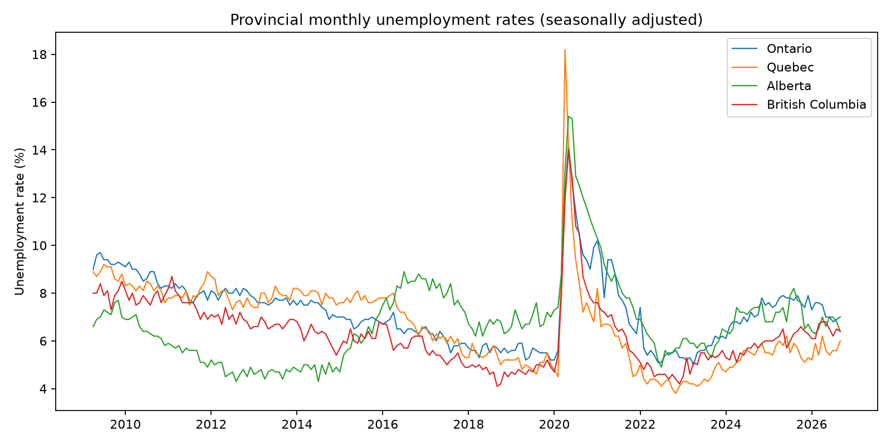
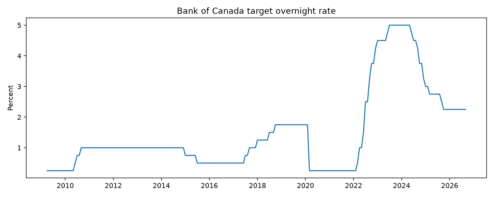

# Canadian Monetary Policy and Unemployment (2009-2026)

**Exploratory economics research | Python · Pandas · Statsmodels · Econometrics**

## Research question
How does the observed association between the Bank of Canada's policy interest rate and unemployment across four Canadian provinces change with lag choice and model controls?

## Summary
I examine monthly Bank of Canada policy-rate data and seasonally adjusted unemployment rates for Ontario, Quebec, Alberta, and British Columbia. I construct an **equally weighted four-province unemployment average** (not the official Canada rate) and estimate five descriptive OLS models with Newey-West/HAC standard errors.

| Specification | Coefficient | p-value | Months |
|---|---:|---:|---:|
| Current rate + month controls | -0.481 | 0.0008 | 210 |
| 3-month lag + month controls | -0.344 | 0.0027 | 207 |
| 6-month lag + month controls | -0.213 | 0.0312 | 204 |
| 12-month lag + month controls | -0.003 | 0.9781 | 198 |
| 3-month lag + month/year controls | -0.198 | 0.3729 | 207 |

Shorter-lag models produce negative coefficients with p-values below 0.05, but the three-month result is not statistically significant once year controls are included. **These are conditional correlations, not causal monetary-policy effects.** Different lag models also use different sample sizes.

## Visualizations



## Methods and limitations
- Public data: [Bank of Canada Valet API V39079](https://www.bankofcanada.ca/valet/observations/V39079/json) and [Statistics Canada Table 14-10-0287-01](https://www150.statcan.gc.ca/t1/tbl1/en/tv.action?pid=1410028701).
- Monthly data, April 2009-September 2026; 210 months in contemporaneous specification.
- OLS with month-of-year indicators, interest-rate lags of 0/3/6/12 months, and a year-controls sensitivity model.
- Standard errors are HAC with 12 lags.
- Endogenous policy decisions, omitted macroeconomic variables, COVID-era shocks, time-series dynamics, and alternative provincial weights limit interpretation.

## Files
- `Canadian_Monetary_Policy_Research_Report.pdf`: concise research report with charts and results
- `model_comparison.csv`: numerical model outputs
- `unemployment_trends.png`, `policy_rate.png`: visualizations
- `analyze.py`: **add your locally tested script from VS Code before publishing**
- `requirements.txt`: **add your existing requirements file before publishing**

## Reproduce
After copying `analyze.py` and `requirements.txt` into this folder:

```bash
python -m pip install -r requirements.txt
python analyze.py
```

The script fetches current source files, so later runs may differ if the sources are revised.
